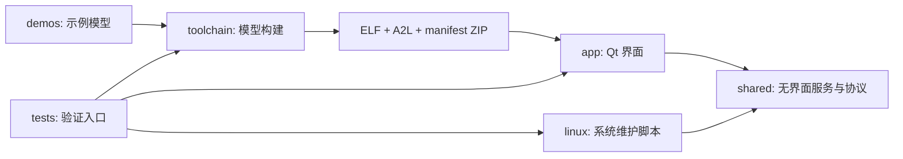

# 目录与清理规则

## 当前功能分类

2026-10-07 起按现有组件职责整理。APP、工具链、Linux 维护、测试和 Demo 是主要导航；跨组件共用的无界面服务单独放在 `shared`，不要求所有内容硬归入五类。移动的是实际文件，不使用旧路径目录联接。

```text
app/         Qt 界面、C++ 核心、正式发布包
shared/      无界面的 Python 服务与 XCP 后端
toolchain/   Simulink 目标、功能库、编译器与开发辅助工具
linux/       实时机系统配置、优化与本地控制台
tests/       单元测试、驱动验证、联调脚本和历史证据
demos/       Demo 模型、配套 ZIP 与生成代码
docs/        跨模块学习、架构、部署与版本说明
```

根目录只额外保留 README、需求、统一依赖和隐藏的本机开发环境。路径移动清单在 [move_map.json](../tests/layout/move_map.json)，执行记录在 [moves_completed.json](../tests/layout/moves_completed.json)。验证与后续共享层移动见 [本轮整理记录](../tests/layout/README.md)。

### 依赖边界



- APP 通过共享服务部署、观测和标定；运行正式 EXE 不需要 MATLAB 或编译器。
- Linux 维护脚本只导入 `shared/python`，无需 Qt、图表库或 APP 源码。实时机控制台和运行期调优脚本保留自身部署入口。
- 工具链负责代码生成、交叉编译和三文件 ZIP，独立于 APP；双方以 ZIP 清单、A2L 和 XCP 协议交互。
- Demo 保留模型和对应构建证据，不复制 APP 源码或编译器。便携导出包可按交付需要收集运行依赖。
- 测试依赖被测模块，产品模块不反向导入测试代码。各组件 README 说明独立入口。

## 1. 保留内容

| 目录/文件 | 为什么保留 | 新机是否复制 |
| --- | --- | --- |
| `app/distribution/`、启动脚本、`demo.json` | 唯一正式 APP；EXE 依赖 `_internal`，不能只留 EXE | 运行 APP 必须整体复制 |
| 正式 SLX、模型 `_local/*.zip` | 用户模型及可部署的配套 ELF/A2L/JSON | 复制所需模型及选定 ZIP；关联验证证据的历史构建 ZIP 保留 |
| `app/qt_xcp_host/qt_host`、`native` | Qt 界面、C++ 数据核心源码 | APP 源码开发需要 |
| `shared/python/pyxcp_host`、`simrt_xcp` | 现有服务包与协议包，不含 Qt 界面 | APP 源码和维护脚本需要 |
| `app/qt_xcp_host/qt_host/native_bin/xcp_core.dll` | 源码运行需要的 Windows 原生库 | 源码运行需要，或用固定编译器重建 |
| `toolchain/simrt_linux_target/` | MATLAB 注册、生成钩子、实时入口、A2L 和 CAN 源码 | 模型开发需要 |
| `toolchain/portable-linux-toolchain/` | Windows 上生成 Linux ELF 所需的 GCC、binutils、sysroot | 模型编译需要，必须完整复制 |
| `toolchain/qt_toolchain/` | Windows C++ DLL 编译器 | 重建 DLL 时需要 |
| `tests`、`service_tests`、验证脚本 | 复现行为和定位回归 | 开发需要 |
| `tests/validation/` 的 JSON、日志、截图、测试模型 | 本轮及历史结论的依据 | 可选，但排障与审计建议保留 |
| 第三方 SDK、SOURCE、manifest、许可证 | CAN 依赖及工具链来源记录 | 使用对应功能时保留 |
| `docs/`、各组件 README、需求说明 | 技术路线、部署、排障与需求基线 | 建议复制 |

`shared/python/pyxcp_host` 是复用的无界面服务包，不是第二套上位机；共享 XCP 后端为 `shared/python/simrt_xcp`。CAN、串口等示例归入 `demos/io`，驱动实现保留在工具链，测试集中在 `tests/drivers`。

## 2. 构建元数据与缓存不同

`<model>_ert_rtw/` 保存生成 C、Makefile、`tmwinternal` 代码描述符及最新回执。其 `simrt_build_evidence/<时间戳>/` 保存 SLX 快照、RT 源码包、ELF 检查和构建报告；内部三文件缓存用于从 ZIP 定位 ELF 和重新导出 A2L。

这些文件可以通过重新生成代码获得，但**不是本次自动清理对象**：它们用于学习生成代码、解释某轮构建和保持旧 ELF 的同轮元数据。只拿旧 ELF 配上另一次代码生成元数据，并不能正确重建 A2L。删除后应完整构建新一轮 ZIP，不能混用旧文件。

时间戳部署目录已只保留 ZIP；内部证据目录出现 ELF 或源码不违反部署产物只留三文件 ZIP 的约定。

## 3. 可以清理的输出

- `app/qt_xcp_host/build/`、`dist/`：PyInstaller 构建和待发布结果。确认正式交付已更新后可删，再次发布前重新运行 `build.ps1`。`SimRT.spec` 是维护的打包入口，清理脚本保留它。
- 已验证并发布的 `staging_delivery/`、`replaced_app_files/`、旧 EXE 备份：重复交付和替换过程文件。原始测试报告、哈希及发布记录继续保留。
- 工程自己的 `__pycache__/`、`.pyc`：Python 字节码缓存，重新运行自动产生。
- `slprj/`、`.slxc`：Simulink 可再生缓存，重新编译或仿真可能重建。不要在构建或仿真执行期间清理。
- 主模型 `_local/` 内时间戳展开目录：只有三个文件与保留的同名 ZIP 内容及 SHA-256 完全一致才清理；无 ZIP 或内容不同则保留。

`.gitignore` 已排除上述常见输出，但忽略规则不会自动删除文件，也不会忽略正式模型 ZIP 或生成证据。

## 4. 本机环境与辅助工具

`.python/`、`.venv/`、`.vscode/` 保留以支持当前机器。它们可能含旧绝对路径，不能原样当作新机环境；按 [新机部署指南](NEW_MACHINE_DEPLOYMENT.md) 重建环境并更新配置。

`toolchain/development/matlab-agentic-toolkit`、`simulink-agentic-toolkit`、MCP 二进制和源码被注册路径/技能链接引用，不作为 APP 缓存删除。它们是开发辅助工具，不是正式 APP 或 Linux 的运行依赖。ARK 库安装和验证入口见 [ARK I/O](ARK_IO.md)。

## 5. 清理命令与记录

先预览，再在确认已完成构建/发布后执行。脚本只处理列出的固定重复输出及项目内常规缓存，不会清空任意指定目录。

```powershell
powershell -NoProfile -ExecutionPolicy Bypass -File ./tests/maintenance/clean_generated.ps1 -ReportDirectory ./tests/validation/cleanup_preview
powershell -NoProfile -ExecutionPolicy Bypass -File ./tests/maintenance/clean_generated.ps1 -Apply -ReportDirectory ./tests/validation/cleanup_applied
```

报告目录必须在工程内。执行前检查最终绝对路径与符号链接/目录联接；删除仅使用 PowerShell `Remove-Item -LiteralPath`。清理前后比对正式 APP、模型产物及源码哈希，删除失败会记录并返回失败。建议每次选择新的报告目录，保留历史清单。

| 报告 | 含义 |
| --- | --- |
| `cleanup_plan.json` | 每个目标的相对路径、文件数和字节数 |
| `removed_files.json` | 本次选择文件的路径、长度、SHA-256；预览时只是候选，不代表已删除 |
| `cleanup_result.json` | 是否执行、实际移除项、失败项和保护文件检查结果；`apply=false` 的预览不是删除成功报告 |

`-IncludeStagedDeliveries` 额外处理脚本中明确列出的 2026-10-05 暂存交付与旧 APP 备份。删除暂存交付前核对其中模型/验证 ZIP 与主模型或保留证据的哈希，遇到独有模型则停止。当前正式 APP 位于 `app/distribution`，最近一次回退副本 `tests/validation/startup_network_time_20261005_previous_app/app` 继续保留；清理不会变更 MATLAB 注册、目标机系统或正在运行的正式 APP。

最新结果见 [2026-10-06 清理记录](../tests/validation/project_cleanup_20261006/README.md)，完整快照与学习路线见 [SimRT 2026.10.06](VERSION_20261006.md)；[2026-10-05](../tests/validation/project_cleanup_20261005/README.md)及[2026-09-19 清理记录](../tests/validation/project_cleanup_20260919/README.md)仅说明当时结果。后续运行 Python/MATLAB 会重新产生部分缓存，这是正常行为。

本轮目录迁移同步调整源码、启动脚本、MATLAB 注册、VS Code MCP 设置和当前文档路径。历史 JSON、日志、部署 ZIP 与旧构建证据保留原内容；其中旧绝对路径通过迁移清单追溯。已有模型在新路径重新编译后会产生新的 Makefile 和回执，不能把旧元数据的路径替换理解为一次新验收。
